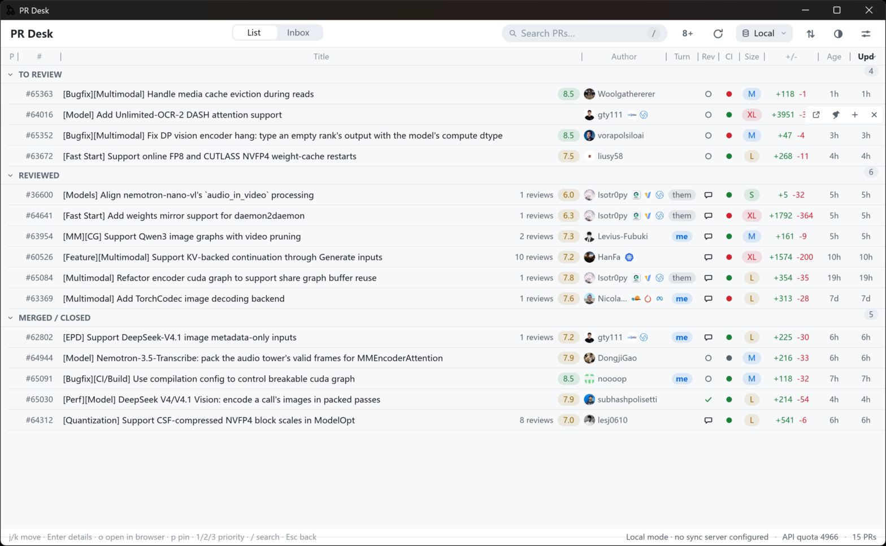
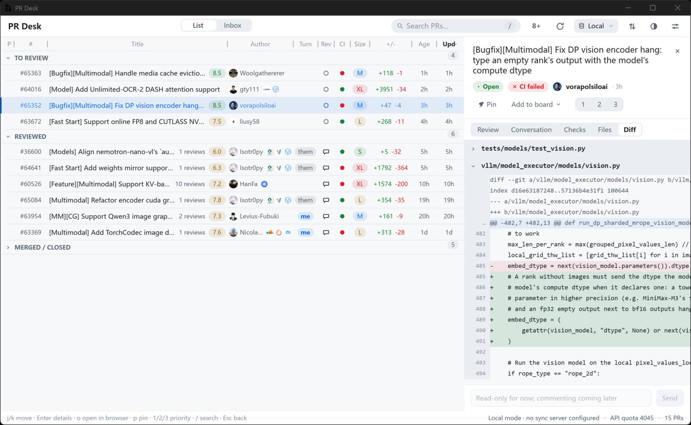

# PR Desk (pr-desk-rs)

A high-density GitHub PR pre-review workbench for the desktop (Rust + egui).

The desktop UI uses egui/eframe and includes PR management, review, inbox,
settings, batch actions, and tray integration.

Pairs with the AstrBot plugin
[`astrbot_plugin_github_pr_review`](../astrbot_plugin_github_pr_review):
the plugin runs the review pipeline (LLM reviews, SQLite storage, QQ push),
while this app provides the local workbench UI and syncs state back to the
plugin over its sync API (pins / priorities / board / tags / todos).




## Features

**PR workspace**

- Grouped PR list (pinned / board / to-review / reviewed / merged-closed)
  with avatars, org icons, review scores, CI state, size and +/- columns
- Excel-style column sorting, high-score quick filter, `/` search
- Detail panel with tabs: Review (dimension scores, summary, flagged files,
  line-level comments), Conversation, Checks, Files/Diff, and an embedded Kimi
  CLI session
- Diff viewer with real line numbers (parsed from hunk headers), per-file
  collapse, compact variable-height files, and GitHub-style horizontal scrolling
- One-click LLM pre-review with concurrency slots, live progress and cancellation;
  optionally run pre-review automatically when a PR is added
- Embedded Kimi CLI provides the full terminal experience, including plugins,
  slash commands and session resume. Each PR receives a persistent complete Git
  worktree with base/head history, the PR description and diff, so reviews are
  not limited to the changed hunks. The workspace root is configurable, and the
  terminal follows the app's light/dark and Glass themes.

**Inbox**

- GitHub notifications with repo filter, unread-only toggle, and pagination
- Preview pane (conversation / files / diff) without leaving the inbox
- Mark-all-read (two-step confirm), one-click "add to pre-review"

**Sync & data sources**

- Bidirectional sync with the AstrBot plugin: local changes queue in an
  outbox and push; conflicts resolve server-wins
- Multiple data-source profiles (local + remote) with instant switching
- Local mode: manual curation only — a GitHub token and a repo list are
  enough, no server required

**UX**

- Bilingual UI (zh/en) with live switch, light/dark theme, font scaling
- Import a GitHub PR directly from its URL with the `+ URL` dialog, or press
  `Ctrl+V` (`Cmd+V` on macOS) to import the PR URL currently on the clipboard
- Keyboard-first: arrow keys navigate, `PgUp`/`PgDn` move by page,
  `Enter` open, `Esc` close/back, `p` pin, `1`/`2`/`3` priority,
  `o` open in browser
- Window size and panel width persist across restarts

## Build & run

- Toolchain: **x86_64-pc-windows-gnu** (pure Rust, no MSVC/OpenSSL)
- Stack: reqwest + rustls, rusqlite (bundled), egui/eframe (glow renderer)

```bash
cargo run --release
# low-memory machines (Windows page-file pressure crashes rustc):
scripts/build-release.sh   # = CARGO_INCREMENTAL=0 cargo build --release -j2
```

Runtime requirements:

- `git` on PATH — local pre-review and Kimi sessions use a persistent PR
  worktree containing the base/head commits and their history (see `src/ocr.rs`)
- An installed, signed-in `kimi` CLI — required only for the embedded terminal;
  configure a custom executable with `kimi_cli_path` and a durable workspace
  location with `kimi_workspace_root`
- `bin/ocr.exe` (open-code-review CLI, bundled sidecar) — the line-comment
  review engine. Lookup order: `ocr_path` config (when non-default) →
  `bin/ocr.exe` next to the exe → `bin/ocr.exe` in the working directory →
  PATH. Without it only line-level comments are unavailable; scored reviews
  (pure LLM) still work.

### Shared Git object cache

PR worktrees share one bare Git mirror per remote repository under
`<kimi_workspace_root>/.git-mirrors/`. Their `.git/objects/info/alternates`
entries reference these mirrors, so base/head history is downloaded once rather
than duplicated for every PR. Checked-out files, branches and local edits remain
independent for each PR, and `git pull` still uses the real GitHub remote.

Deleting a mirror does not delete checked-out files, but worktrees that reference
it can lose access to their Git history. Keep mirrors together with the workspace
when moving or backing it up; rebuild missing mirrors before relying on offline
history.

### Renderer note

The UI renders with eframe's **glow** backend. The wgpu stack is not
compiled in (`eframe` default-features off): it was the single largest
contributor to binary size and build memory (its static link could blow
the Windows page file). Text uses native system fonts with Source Han
Sans/Noto and JetBrains Mono preferred when installed, including correct
variable-font weight selection.

## Configuration

On first launch a `config.toml` template is created next to the exe.
**Prefer editing it from the in-app ⚙ settings page** (hot-reloads, no
restart) — it covers server URL, sync token, GitHub token, proxy, repo list,
poll interval, LLM settings, and data-source profiles. When unconfigured, the
app shows an onboarding card and opens settings (skippable for local mode).

The database and avatar cache live in `data/` next to the config file.
Config resolution: `config.toml` next to the exe wins; if absent, a
`config.toml` in the working directory is used in place (so dev runs from
the repo root keep their data outside `target/` where `cargo clean` can't
eat it).

```toml
server_url = "http://127.0.0.1:6185"   # AstrBot address
sync_token = ""                        # sync_token from the plugin config (empty = local browsing only)
github_token = ""                      # stored in plaintext (personal use); GITHUB_TOKEN env var takes precedence
proxy = ""                             # http:// or socks5:// proxy for GitHub / LLM requests only (empty = direct; sync server always direct)
repos = ["owner/repo"]                 # repos to watch (open PRs)
poll_interval_min = 5                  # auto-sync interval (minutes)
# renderer: REMOVED — the software renderer is now the only one compiled in;
# the field is still parsed for backward compatibility but its value is ignored.
```

> **Token storage**: `github_token` / `sync_token` / `llm_api_key` are stored
> in plaintext in `config.toml` (this is a personal-use app). Don't commit or
> share a config file containing tokens. Windows has no reliable `0600`
> equivalent — use the `GITHUB_TOKEN` environment variable if you want the
> token to never touch disk (it takes precedence over the file).

## Testing

```bash
cargo test --lib                          # logic suite (no UI dependency)
cargo test                                # full suite (compiles the egui UI)
```

Coverage includes: sync merge semantics (server-wins / applied not
overwritten / outbox merge / pull upsert), idempotent local upserts,
cursor/outbox/diff cache, diff parsing (hunk line numbers, file splitting),
config round-trip (escapes, inline comments, atomic writes), review-comment
preservation on re-review, legacy database compatibility, automatic pre-review
queueing, persistent Kimi workspace paths, real terminal I/O, and UI-side
identity guards against stale async deliveries.

## Roadmap

- Desktop versions of the todo / queue / board tabs
- Packaging & distribution (cargo-dist / installer)

## License

[GPLv3](LICENSE).
