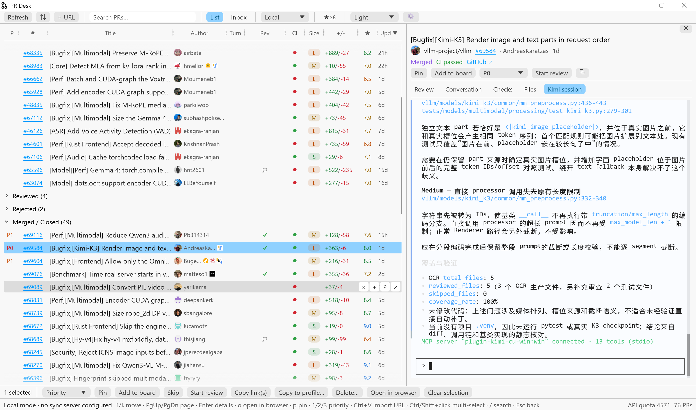

# PR Desk (pr-desk-rs)

A native GitHub PR review workbench built with Rust and egui/eframe. It combines
a dense, keyboard-driven PR dashboard with LLM/OCR pre-review and a real,
embedded Kimi CLI.




> [!NOTE]
> This is a personal app built around my own review workflow. The source is
> shared for reference; some defaults and tooling reflect that workflow.

## What it does

- Shows PRs in dense, sortable groups with review scores, CI, author, turn,
  diff size and age. Includes search, batch actions and keyboard navigation.
- Provides conversation, checks and a compact Files/Diff view with real line
  numbers and per-file collapse.
- Runs conventional LLM pre-reviews with summaries, dimensions and OCR
  line-level comments, live progress and optional auto-review.
- Runs persistent Kimi deep reviews with structured findings, resumable sessions,
  incremental re-reviews and a Needs-you inbox for reports, stale heads, CI and
  agent decisions.
- Embeds the full Kimi CLI, including plugins, MCP tools, slash commands and
  resumable sessions. Multiple PR sessions can stay open at once.
- Gives each PR a persistent Git worktree with base/head history, the PR body
  and diff. New commits do not force a session reset, and `git pull` follows the
  current PR ref without downloading tags.
- Includes GitHub notifications, local/remote data-source profiles, database
  export, and database import as a copy in a new profile.
- Supports Chinese and English, light/dark and Glass themes, font scaling and
  tray integration.

## Building

Needs a Rust toolchain with 2024 edition support and `git` on PATH.

```sh
cargo run --release

# Lower-memory release build (CARGO_INCREMENTAL=0, -j2; requires Bash)
scripts/build-release.sh
```

Windows is the primary development target. CI also tests and packages Linux
x86_64 and macOS ARM64. A `v*` tag publishes all three platform packages in one
GitHub Release.

Optional runtime tools:

- An installed, signed-in `kimi` CLI for embedded sessions.
- `bin/ocr.exe` for OCR line-level comments. Run `python scripts/fetch_ocr.py`
  to download it, or set `ocr_path`. Scored LLM reviews work without OCR.
- An OpenAI-compatible endpoint for conventional pre-review. Kimi CLI uses its
  own account and configuration.

The UI uses eframe's glow renderer; wgpu/naga is intentionally not compiled.

## Configuration

A commented `config.toml` is created on first launch. Prefer editing it from the
in-app settings page, which covers GitHub access, LLM/OCR settings, concurrency,
automatic pre-review, themes, data-source profiles and Kimi paths.

Configuration is read from `config.toml` beside the executable, or from the
working directory when the executable has none. Runtime data lives in `data/`
beside the active configuration file.

`GITHUB_TOKEN` and `LLM_API_KEY` override their corresponding config values.
Other tokens are stored in plaintext, so do not commit or share the file.

`kimi_workspace_root` defaults to `data/kimi-workspaces` and can be absolute or
relative to the data directory. PR worktrees share one bare mirror per remote
repository under `.git-mirrors/` through Git alternates, avoiding duplicate
history and pack files. Keep mirrors with the workspace when moving or backing
it up; deleting one can leave dependent worktrees without their Git history.

## Agent deep reviews

**Review with Kimi** creates a durable review session and run queue in the active
profile's SQLite database. Each run captures a consistent base/head/diff snapshot.
Only a complete, validated report can advance the reviewed head. Failures,
cancellations, partial reports, CI-only checks and late superseded runs do not
move that baseline.

A new PR head marks the review stale. Re-review resumes the same Kimi session,
checks the delta from the last successful head, and reconciles every previous
finding as open, fixed or obsolete. Findings also have independent local
accept/dismiss/reopen decisions. The Needs-you view collects unread reports,
failures, stale reviews, CI failures and agent decision cards.

`agent_review_concurrency` defaults to 2 and is independent of conventional
pre-review concurrency. `auto_agent_rereview` defaults to `false`; enable it only
when automatic Kimi quota usage is acceptable. Quiet watch polls never invoke a
model.

Reviews are read-only by default. GitHub comments, review submission, merge,
push and code edits require an application-level confirmation separate from the
agent's suggestion. Free text is only accepted for clarification. Every external
action rechecks that its run head, reviewed head and remote head still match;
stale decisions cannot write to a newer PR head. The application records the
decision and result. Kimi plugins and MCP tools are not an OS-level sandbox, so
the approval boundary does not replace isolating untrusted repositories or
configuring CLI permissions.

## Testing

```sh
cargo test --all-targets
cargo check --all-targets
```

Tests cover review and sync logic, agent report validation, review baselines,
finding reconciliation, persistent queues, decisions, configuration, database
migration and backup, deep Git history, shared mirror reuse, offline worktree
rebuilding, concurrent context creation and real terminal I/O. Windows desktop
verification scripts are in `scripts/`.

## Third-party

- [egui / eframe](https://github.com/emilk/egui)
- [open-code-review](https://github.com/alibaba/open-code-review), used by the
  optional OCR sidecar
- [egui_xterm](https://crates.io/crates/egui_xterm), with a small vendored patch
  for Glass terminal backgrounds
- [rusqlite](https://github.com/rusqlite/rusqlite)

## License

[GPLv3](LICENSE).
