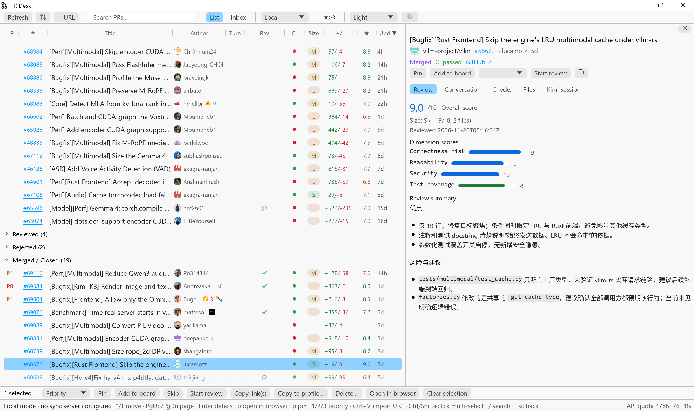

# PR Desk (pr-desk-rs)

A high-density GitHub PR review workbench for the desktop, built with Rust and
egui/eframe. It combines a conventional LLM/OCR pre-review pipeline with a real,
embedded Kimi CLI for repository-aware reviews and follow-up work.

PR Desk can optionally pair with
[`astrbot_plugin_github_pr_review`](../astrbot_plugin_github_pr_review). The
plugin provides remote review storage, synchronization and QQ push; the desktop
app provides the interactive workbench. A remote plugin is not required for
local-only use.



## Features

### PR workspace

- Grouped PR list: pinned, board, to-review, reviewed, and merged/closed.
- Avatars, organization icons, review scores, CI status, change size and +/-
  columns, with sortable headers and a high-score filter.
- Fast search and keyboard navigation; Ctrl/Shift multi-selection for batch
  actions, copying links, deleting, or copying PRs between data-source profiles.
- Detail tabs for Review, Conversation, Checks, Files/Diff, and Kimi CLI.
- Diff viewer with real hunk line numbers, per-file collapse, compact
  variable-height files and horizontal scrolling for long lines.
- Import a PR by URL with `+ URL` or `Ctrl+V` (`Cmd+V` on macOS).

### Review workflows

**Conventional pre-review**

- Scored LLM reports with summaries, dimensions, flagged files and OCR line-level
  comments.
- Configurable concurrency, live progress and child-process cancellation.
- Optional automatic pre-review when a PR is added; this runs only the
  conventional pre-review, not a second agent pipeline.

**Embedded Kimi CLI**

- A real terminal running the installed Kimi CLI, not a reduced chat wrapper.
- Plugins, MCP tools, slash commands and native commands such as `/new`.
- Each PR gets a persistent Git worktree containing base/head commits, the
  history needed for merge-base, `pr-body.md`, `pr.diff` and `pr.json`.
- Sessions resume with `--continue`. Switching PRs does not terminate existing
  sessions, and new commits on a PR do not force a session reset.
- The current terminal plus up to four recently used background terminals are
  kept alive. Older entries are closed least-recently-used first and can later
  resume from their saved session and worktree.
- Worktrees use the real GitHub remote and track `refs/pull/<number>/head` with
  tags disabled, so `git pull` updates only the current PR.
- On Windows the terminal uses ConPTY. Terminal colors and background opacity
  follow the application's regular and Glass themes.

### Inbox

- GitHub notifications with repository filtering, unread-only mode and
  pagination.
- Conversation and file previews without leaving the inbox.
- Two-step mark-all-read confirmation and one-click add to pre-review.

### Data sources and backups

- Multiple local/remote data-source profiles with instant switching.
- Optional bidirectional AstrBot synchronization using an outbox; conflicts
  resolve server-wins.
- Local mode works without a server: curate PRs by URL or from the inbox instead
  of downloading a repository-wide open-PR list.
- Export the active database to a user-selected destination using SQLite's
  online backup, including WAL contents; existing files are never overwritten.
- Import a database as a **copy in a new profile**, after integrity and schema
  validation. The current database is not replaced.

### Desktop experience

- Chinese and English UI with live language switching.
- `light`, `dark`, `glass-light` and `glass-dark` themes, with native backdrop
  support where available and safe fallbacks.
- Font scaling, persistent window size, panel width and centered settings.
- Tray integration, URL import, keyboard shortcuts and clipboard export of
  review reports.

## Build and run

Requirements:

- A Rust toolchain supporting the 2024 edition.
- `git` on PATH.
- An installed, signed-in `kimi` CLI for embedded sessions. Conventional
  pre-review can be used without it.
- `bin/ocr.exe` for OCR line-level comments. Scored LLM reviews still work
  without OCR, but comments are unavailable. OCR lookup order: explicit
  `ocr_path` → `bin/ocr.exe` beside the executable → `bin/ocr.exe` in the working
  directory → PATH.
- An OpenAI-compatible LLM endpoint for conventional pre-review. Kimi CLI uses
  its own account and configuration.

```bash
cargo run --release

# Lower-memory release build (CARGO_INCREMENTAL=0, -j2):
scripts/build-release.sh
```

The release script requires Bash. The primary development and end-to-end test
target is `x86_64-pc-windows-gnu`.

The UI uses eframe's **glow** renderer. The wgpu/naga stack is intentionally not
compiled, keeping binary size and build memory down. Text rendering uses native
system fonts with Source Han Sans/Noto and JetBrains Mono fallbacks.

## Configuration

On first launch, a commented `config.toml` template is created. Prefer editing
settings in the app; changes are saved and applied without a restart where
possible.

Configuration lookup order:

1. `config.toml` beside the executable.
2. Otherwise, `config.toml` in the working directory, used in place.

The database, avatar cache and default Kimi workspace live in `data/` beside the
active configuration file.

A typical configuration looks like:

```toml
server_url = "http://127.0.0.1:6185"
sync_token = ""
astrbot_api_key = ""
github_token = ""
proxy = ""                         # http:// or socks5://; empty = direct
repos = ["owner/repo"]
poll_interval_min = 5

theme = "glass-dark"              # light / dark / glass-light / glass-dark
language = "zh"                   # zh / en
font_scale = 1.0                  # 0.9 / 1.0 / 1.15

llm_base_url = "https://api.openai.com/v1"
llm_api_key = ""
llm_model = ""
ocr_path = "ocr"
review_concurrency = 16           # 1-16
auto_review_on_insert = false

kimi_cli_path = "kimi"
kimi_workspace_root = ""          # empty = data/kimi-workspaces
active_profile = "local"
```

Environment variables `GITHUB_TOKEN` and `LLM_API_KEY` take precedence over the
corresponding configuration values. Token values are otherwise stored in
plaintext in `config.toml`; do not commit or share that file. Proxy settings are
explicit: GitHub and LLM requests use `proxy`, while synchronization requests
connect directly.

Remote profiles use `profile.<name>.server_url`, `profile.<name>.sync_token` and
`profile.<name>.api_key`. The `default` profile maps to the top-level server
fields, while `local` is the built-in local database.

### Kimi workspaces and shared Git objects

`kimi_workspace_root` may be absolute or relative; relative paths are anchored
to the data directory. Each PR context has its own worktree and session files.

All contexts also share bare mirrors under:

```text
<kimi_workspace_root>/.git-mirrors/
```

There is one mirror per remote repository. New worktrees reference mirror
objects through `.git/objects/info/alternates`, avoiding duplicate history and
pack files. Mirror updates are serialized per repository within the app, and
only missing commits or insufficient history are fetched.

Keep mirrors together with the workspace when moving or backing it up. Deleting
a mirror does not delete checked-out files, but dependent worktrees can lose
access to Git history until the mirror is rebuilt. Automatic mirror capacity
cleanup is not currently implemented.

## Testing

```bash
cargo test --all-targets
cargo check --all-targets
```

The suites cover synchronization, database migration and backup, configuration,
review parsing and queueing, diff parsing, deep Git history, shared mirror reuse,
offline worktree rebuilding, concurrent context creation, real terminal I/O,
and stale asynchronous UI delivery.

Optional desktop end-to-end drivers (Windows, `PR_DESK_TEST=1`) are in
`scripts/`:

- `verify1_list.sh`
- `verify2_detail.sh`
- `verify3_inbox.sh`
- `verify4_kimi_terminal.sh`
- `verify4_settings_tray.sh`

They use the shared helpers in `scripts/verify.sh` for command injection, state
assertions and screenshots.

## License

[GPLv3](LICENSE).
