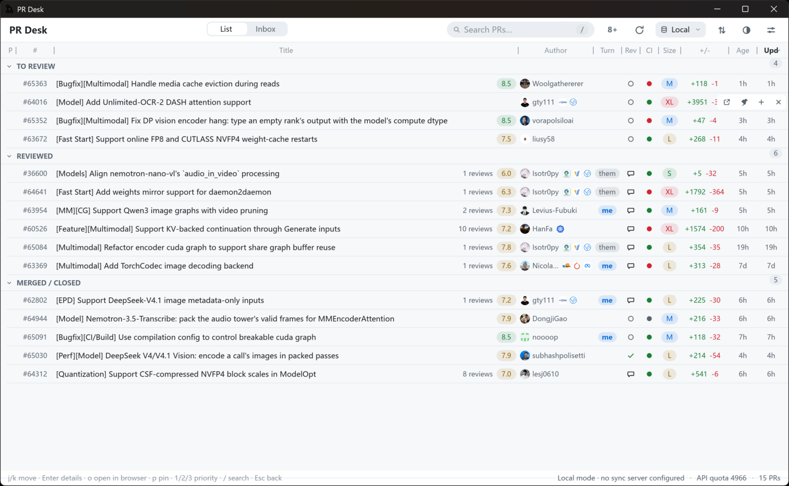
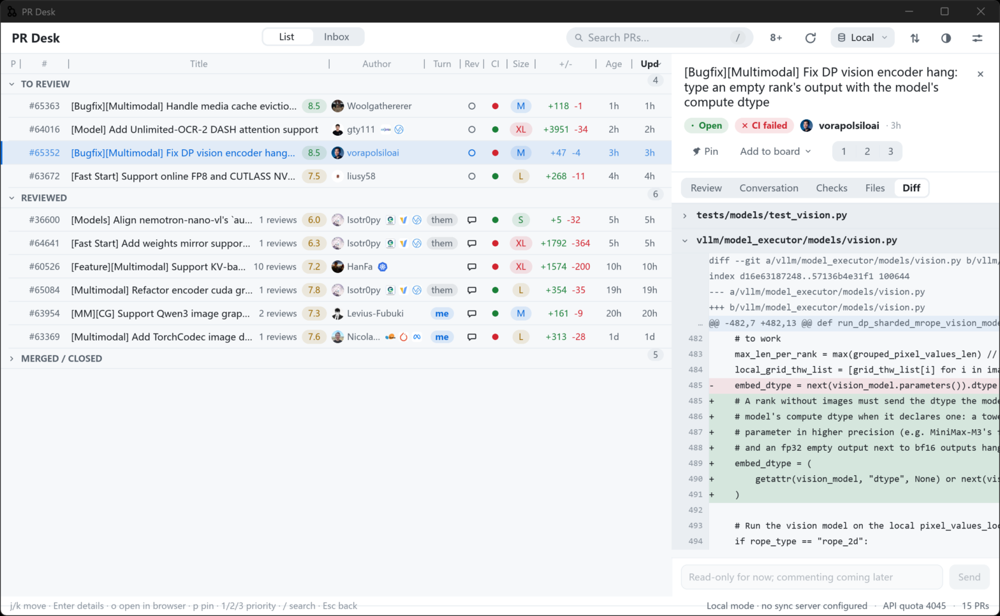

# PR Desk (pr-desk-rs)

A high-density GitHub PR pre-review workbench for the desktop (Rust + Slint).

Pairs with the AstrBot plugin
[`astrbot_plugin_github_pr_review`](../astrbot_plugin_github_pr_review):
the plugin runs the review pipeline (LLM reviews, SQLite storage, QQ push),
while this app provides the local workbench UI and syncs state back to the
plugin over its sync API (pins / priorities / board / tags / todos).




## Features

**PR workspace**

- Grouped PR list (pinned / board / to-review / reviewed / merged-closed)
  with avatars, org icons, review scores, CI state, size and +/- columns
- Excel-style column sorting, high-score quick filter, `/` search
- Detail panel with tabs: Review (dimension scores, summary, flagged files,
  line-level comments), Conversation, Checks, Files, Diff
- Diff viewer with real line numbers (parsed from hunk headers), per-file
  collapse, and GitHub-style whole-table horizontal scrolling
- One-click LLM pre-review with concurrency slots and live progress;
  copy the review report as Markdown

**Inbox**

- GitHub notifications with repo filter, unread-only toggle, and pagination
- Preview pane (conversation / files / diff) without leaving the inbox
- Mark-all-read (two-step confirm), one-click "add to pre-review"

**Sync & data sources**

- Bidirectional sync with the AstrBot plugin: local changes queue in an
  outbox and push; conflicts resolve server-wins
- Multiple data-source profiles (local + remote) with instant switching
- Local mode: manual curation only — a GitHub token and a repo list are
  enough, no server required

**UX**

- Bilingual UI (zh/en) with live switch, light/dark theme, font scaling
- Keyboard-first: `j`/`k` navigate, `Enter` open, `Esc` close/back,
  `p` pin, `1`/`2`/`3` priority, `o` open in browser, `PgUp`/`PgDn` scroll
- Window size and panel width persist across restarts

## Build & run

- Toolchain: **x86_64-pc-windows-gnu** (pure Rust, no MSVC/OpenSSL)
- Stack: reqwest + rustls, rusqlite (bundled), Slint (software renderer)

```bash
cargo run --release
# low-memory machines (Windows page-file pressure crashes rustc):
scripts/build-release.sh   # = CARGO_INCREMENTAL=0 cargo build --release -j2
```

Runtime requirements:

- `git` on PATH — local pre-review (line-level comments) rebuilds the PR's
  base/head commits in a temp dir (see `src/ocr.rs`)
- `bin/ocr.exe` (open-code-review CLI, bundled sidecar) — the line-comment
  review engine. Lookup order: `ocr_path` config (when non-default) →
  `bin/ocr.exe` next to the exe → `bin/ocr.exe` in the working directory →
  PATH. Without it only line-level comments are unavailable; scored reviews
  (pure LLM) still work.

### Renderer note

The UI renders with Slint's **software renderer** (CPU raster + partial
redraws) — the only renderer compiled in. The wgpu/femtovg GPU stack was
dropped: it was the single largest contributor to binary size and build
memory (its static link could blow the Windows page file), and this app's
content (text rows + small avatar images) is the software renderer's best
case. To bring GPU rendering back, re-add `renderer-femtovg-wgpu` to the
slint features in `Cargo.toml` and set `SLINT_BACKEND=winit-femtovg`.

## Configuration

On first launch a `config.toml` template is created next to the exe.
**Prefer editing it from the in-app ⚙ settings page** (hot-reloads, no
restart) — it covers server URL, sync token, GitHub token, proxy, repo list,
poll interval, LLM settings, and data-source profiles. When unconfigured, the
app shows an onboarding card and opens settings (skippable for local mode).

The database and avatar cache live in `data/` next to the config file.
Config resolution: `config.toml` next to the exe wins; if absent, a
`config.toml` in the working directory is used in place (so dev runs from
the repo root keep their data outside `target/` where `cargo clean` can't
eat it).

```toml
server_url = "http://127.0.0.1:6185"   # AstrBot address
sync_token = ""                        # sync_token from the plugin config (empty = local browsing only)
github_token = ""                      # stored in plaintext (personal use); GITHUB_TOKEN env var takes precedence
proxy = ""                             # http:// or socks5:// proxy for GitHub / LLM requests only (empty = direct; sync server always direct)
repos = ["owner/repo"]                 # repos to watch (open PRs)
poll_interval_min = 5                  # auto-sync interval (minutes)
# renderer: REMOVED — the software renderer is now the only one compiled in;
# the field is still parsed for backward compatibility but its value is ignored.
```

> **Token storage**: `github_token` / `sync_token` / `llm_api_key` are stored
> in plaintext in `config.toml` (this is a personal-use app). Don't commit or
> share a config file containing tokens. Windows has no reliable `0600`
> equivalent — use the `GITHUB_TOKEN` environment variable if you want the
> token to never touch disk (it takes precedence over the file).

## Testing

```bash
cargo test                                # full suite (compiles the Slint UI)
cargo test --no-default-features --lib    # fast: logic only, skips Slint
```

Coverage includes: sync merge semantics (server-wins / applied not
overwritten / outbox merge / pull upsert), idempotent local upserts,
cursor/outbox/diff cache, diff parsing (hunk line numbers, file splitting),
config round-trip (escapes, inline comments, atomic writes), review-comment
preservation on re-review, and UI-side identity guards against stale
async deliveries.

## Roadmap

- Desktop versions of the todo / queue / board tabs
- Packaging & distribution (cargo-dist / installer)

## License

[GPLv3](LICENSE) (Slint is dual-licensed GPLv3/commercial; this project
follows the GPLv3 path).
